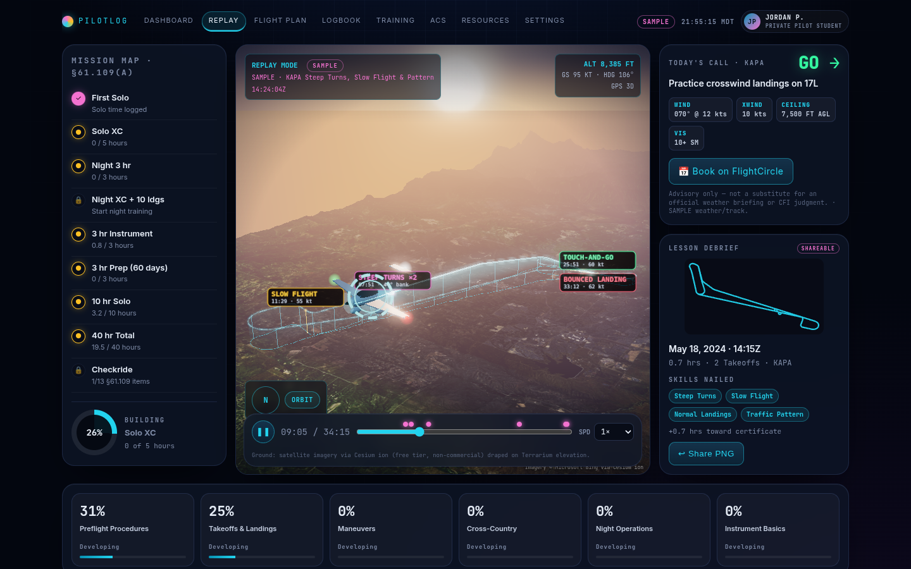

# PilotLog

**The flight-training cockpit for student pilots.** Replay every lesson in 3D, practice your radio calls with an AI tower, and always know exactly how close you are to your checkride.

PilotLog works for any student at any airport, in any trainer. Set your home field, aircraft, instructor and scheduler once, and the whole app adapts.

## Try it
- [Cockpit dashboard (demo)](https://pilotlog.digitalaviationpool.com/cockpit?demo=1)
- [3D flight replay (demo)](https://pilotlog.digitalaviationpool.com/cockpit/replay?demo=1)
- [Radio Practice (demo)](https://pilotlog.digitalaviationpool.com/cockpit/radio?demo=1)

Demo mode uses a labeled SAMPLE student, flight and weather.

## What it does
- **3D flight replay.** Import a GPX, KML or ForeFlight/Garmin CSV track and fly it again over real terrain. A scrubber, orbit, focus and chase cameras, and live ALT/GS/HDG readouts let you step through it. Steep turns, slow flight, touch-and-goes and bounced landings are detected automatically.
- **Radio Practice.** Five Class D scenarios: taxi, takeoff, pattern entry, touch-and-go and full stop. Speak or type your calls and an AI tower replies in standard phraseology, using your airport's real runways, taxiways and frequencies. It then grades your readback against the AIM and 7110.65. Training only; this is not real ATC.
- **Today's Call.** GO / CAUTION / NO-GO from live METAR/TAF measured against your personal minimums, plus a suggested focus for the lesson and a button to book in your own scheduler (FlightCircle, Flight Schedule Pro, Schedule Master, myFBO or any link).
- **Mission Map.** Every 14 CFR 61.109(a) private pilot requirement, tracked from your logbook.
- **Checkride Tracker.** Readiness, endorsements, ACS progress and a training cost forecast.
- **Lesson Debrief.** A shareable card for each flight with a PNG export.
- **Logbook.** Create, edit and review your flight entries.

## Run it locally
Requires Node.js 22+.

    git clone https://github.com/hbrazier01/Pilotlog.git
    cd Pilotlog
    npm install
    node pilotlog-cli/src/readApi.mjs   # http://localhost:8788
    npm test

### Optional: satellite ground on the replay
Set `CESIUM_ION_TOKEN` as a server environment variable (see `.env.example`). The token stays on the server; the browser only calls `/api/imagery/...`. Cesium ion's free tier is non-commercial. Without a token the replay uses stylized terrain.

## Data sources
aviationweather.gov (METAR, TAF, airports), OpenStreetMap (taxiways, attribution required), OurAirports (frequencies), AWS Terrain Tiles, and Cesium ion / Bing Maps (imagery). Always verify against official sources and your CFI.

## Built on Midnight
PilotLog's longer-term vision is a portable, verifiable pilot identity: a Pilot Passport (e.g. `hbrazier.night` via Midnames), chain-linked flight records and privacy-preserving attestations, built with Midnight Compact contracts, the Midnight SDK and the 1AM wallet on PreProd. To try the wallet features, install the 1AM Wallet extension, switch it to Midnight PreProd, and click **Connect Wallet**.

## Status
In active development. Not a substitute for an official weather briefing, ATC or your instructor's judgment.

## Stack
Node.js, Express, vanilla JS, three.js, the Web Speech API, the Midnight SDK and Compact. Deployed on Railway.
